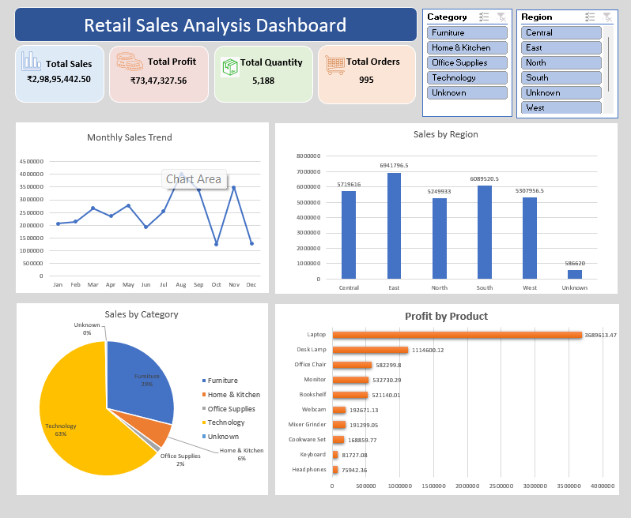

# Retail Sales Analysis Dashboard

## Project Overview
This project analyzes retail sales data using Microsoft Excel to identify sales trends, regional performance, category-wise sales distribution, and product-wise profitability.

An interactive dashboard was developed using PivotTables, PivotCharts, KPI cards, and slicers to make business insights easier to understand.

## Tools Used
- Microsoft Excel
- Power Query for data cleaning and transformation
- PivotTables and PivotCharts
- Excel slicers for interactive filtering
- Excel formulas and data visualization

## Dashboard Features
- **Total Sales:** Displays overall sales revenue.
- **Total Profit:** Shows total profit generated.
- **Total Quantity:** Displays the total quantity sold.
- **Total Orders:** Shows the order count.
- **Monthly Sales Trend:** Analyzes sales performance across months.
- **Sales by Region:** Compares sales across different regions.
- **Sales by Category:** Visualizes category-wise sales distribution.
- **Profit by Product:** Compares profitability across products.
- **Interactive Filters:** Region and Category slicers dynamically update the dashboard.

## Data Cleaning
The dataset was cleaned using Power Query. Data preparation included handling missing values, removing duplicate records, standardizing text values, correcting date formats, and validating sales values.

## Key Insights
- The East region recorded the highest sales among the listed regions.
- Technology represented the largest share of category-wise sales in the analyzed dataset.
- Laptop was the highest-profit product in the dashboard.
- Interactive slicers enable users to explore performance by region and category.

## Files Included
- `Retail_Sales_Analysis_Dashboard.xlsx` — Excel dashboard with KPI cards, PivotTables, charts, and slicers.

## How to Use
1. Download the Excel workbook from this repository.
2. Open it in Microsoft Excel.
3. Use the Region and Category slicers to explore the dashboard.
4. Review the KPIs and charts to analyze sales performance.

## Project Purpose
This project demonstrates practical skills in Excel data cleaning, data analysis, dashboard development, and business data visualization.
